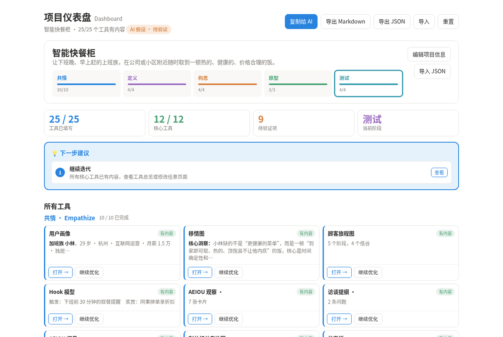
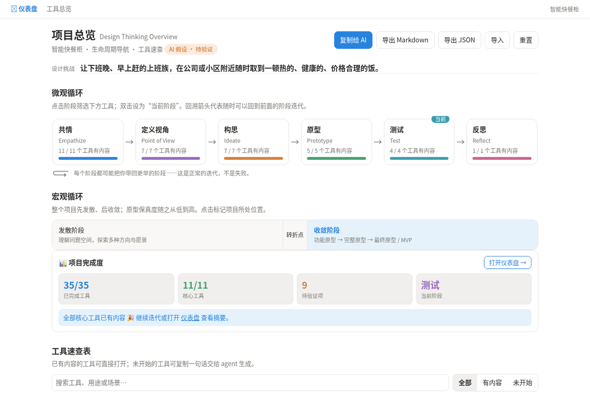
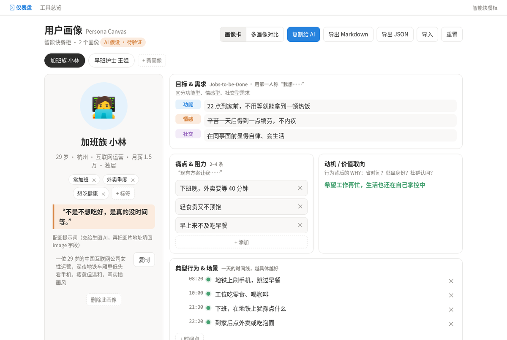
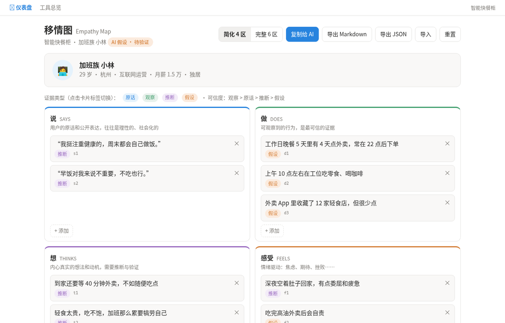
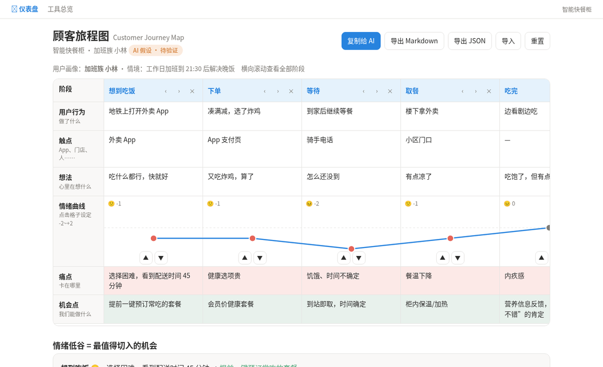
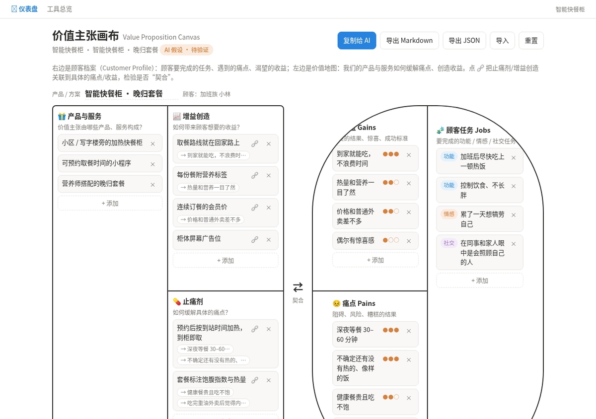
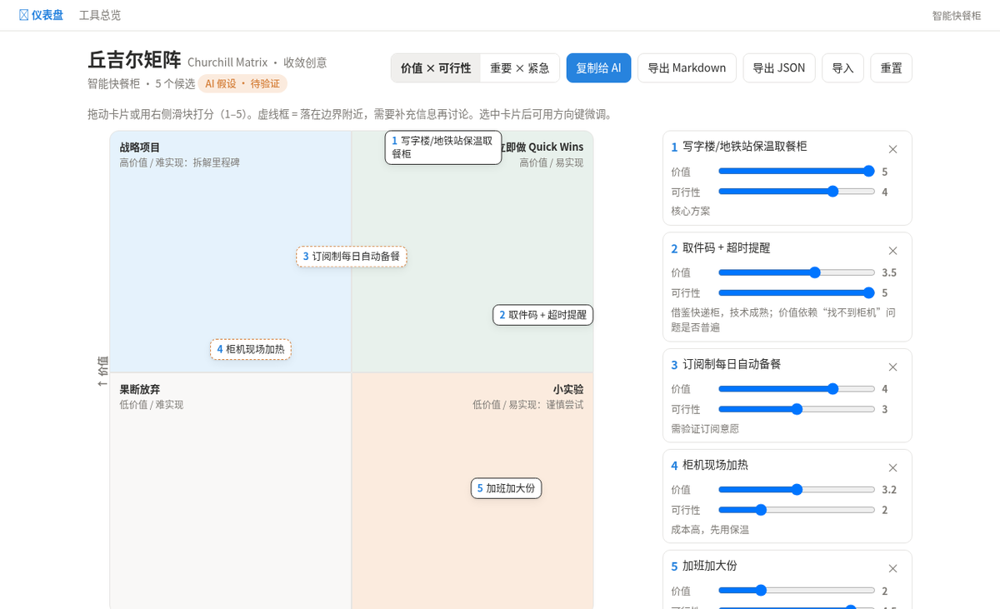
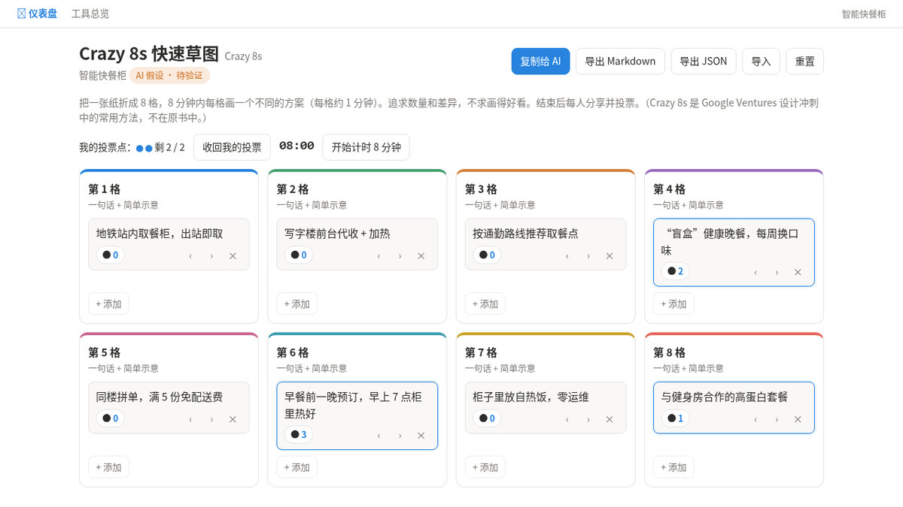
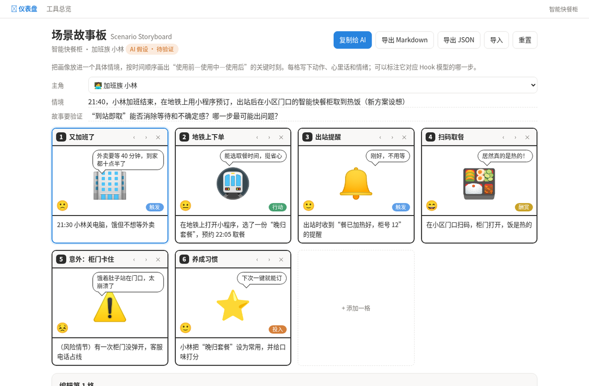
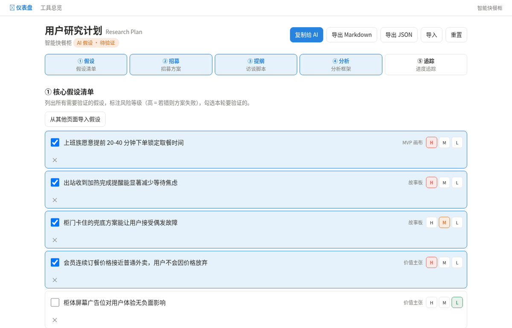

# 设计思维 Skill（AI 辅助 · 中文）

[](LICENSE)
[](LICENSE)
[](references/tools-index.md)
[]()

让 AI agent 带你走完设计思维全流程：**共情 → 定义视角 → 构思 → 原型 → 测试 → 反思**。每个步骤、每个工具都会生成一个**可交互的图形化页面**，直接在浏览器里打开，无需服务器、无需联网。

**你只需要对 agent 说一句话，剩下全部由 agent 完成。**

---

## ✨ 能做什么

- **35 个工具页面**，覆盖设计思维全流程：用户画像、移情图、顾客旅程图、Hook 模型、AEIOU 观察、访谈提纲、AEIOU 问卷、利益相关者地图、极端/未来用户、竞品分析、洞察聚类、360 度视角、九宫格、雏菊图、JTBD → PoV → HMW、关键假设清单、价值主张画布、故事板、头脑风暴墙、Crazy 8s、SCAMPER、问题反转、跨行业对标、点子沟通表、丘吉尔矩阵、盒子原则、架子原则、原型工作坊、服务蓝图、MVP 画布、用户研究计划、测试计划、反馈收集表、A/B 测试、试验表、回溯板
- **项目仪表盘**（`dashboard.html`）作为统一入口，显示所有工具完成状态、内容摘要、下一步建议
- **页面间数据自动同步**：修改任意页面，其他页面立刻更新
- **内置 AI 工作流**：每个工具有"复制给 AI"和"质量自评"按钮，改完直接贴回对话
- 单文件 HTML，**离线可用**，无第三方依赖；支持深色模式与手机端

## 🖼 页面预览

> 以下截图来自「智能快餐柜」示例项目（AI 假设数据，仅作演示）。

### 项目仪表盘 — 统一入口
打开 `dashboard.html` 即可看到所有工具的完成状态、内容摘要和下一步建议。



### 项目总览 — 工具速查
35 个工具按阶段分组，有内容可直接打开，没有内容一键复制生成指令给 AI。



### 共情阶段

**用户画像**：10 步法画像画布，区分功能/情感/社交需求，附图片生成提示词。



**移情图**：Says / Thinks / Does / Feels 四象限，自动检测"说 vs 做"矛盾，提炼核心洞察。



**顾客旅程图**：分阶段行为 + 情绪曲线 + 机会点。



### 定义阶段

**价值主张画布**：顾客任务/痛点/收益 ↔ 产品/止痛剂/增益，自动计算契合度，检测"自嗨功能"。



### 构思阶段

**丘吉尔矩阵**：影响力 × 可行性 二维收敛，拖拽排序。



**Crazy 8s**：8 分钟 8 个草图方案，内置计时器和投票。



### 原型 / 测试阶段

**场景故事板**：用分镜呈现用户在具体情境中的经历，含情绪弧线和 Hook 阶段标注。



**用户研究计划**：从假设清单到访谈提纲到分析框架，一键生成对应的 AI prompt。




---

## 🚀 快速开始

### 安装

```bash
# Claude Code（全局）
mkdir -p ~/.claude/skills && git clone https://github.com/你的用户名/design-thinking-skill.git ~/.claude/skills/design-thinking

# Claude Code（项目内）
mkdir -p .claude/skills && git clone https://github.com/你的用户名/design-thinking-skill.git .claude/skills/design-thinking

# Codex / 其他支持 skills 的 agent
# 克隆到该 agent 文档说明的 skills 目录
```

> **不支持 skills 目录的 agent**：把 `SKILL.md` 内容粘贴为系统提示 / 项目说明，并确保 agent 能读取本文件夹。

### 使用

对 agent 说：

```
用设计思维帮我分析一个想法：给加班的上班族做一个智能快餐柜
```

agent 会自动完成：
1. 生成项目数据
2. 渲染所有工具页面到 `design-thinking/<项目名>/pages/`
3. 在浏览器打开 `pages/dashboard.html`

**你不需要运行任何命令。**

### 先看示例

打开 `examples/demo/dashboard.html`（智能快餐柜，AI 假设数据）或 `examples/demo-clinic/dashboard.html`（社区医院慢病复诊，另一个示例）。

---

## 📁 目录结构

```
SKILL.md                    agent 入口（安装后 agent 自动读取）
README.md                   本文件
LICENSE                     MIT（代码）+ CC BY-NC-SA 4.0（内容）

templates/                  35 个交互模板（单文件 HTML，离线可用）
  dashboard.html            ← 项目统一入口，双击即可打开
  overview.html             工具速查 + 项目进度
  persona.html              用户画像
  ...（其余 32 个工具页面）

presets/                    看板 / 表格 / 环形图预设（20+ 个）
  boards.json               头脑风暴、AEIOU、回溯板等
  tables.json               访谈提纲、试验表、测试计划等
  radials.json              雏菊图、360 视角、利益相关者等

scripts/
  render.py                 渲染脚本（Python 标准库，agent 自动调用）
  validate.py               数据质量检查

references/                 agent 读取的方法论与提示词
  empathize.md              共情阶段方法
  define.md                 定义视角方法
  ideate.md                 构思方法
  prototype.md              原型方法
  test.md                   测试方法
  reflect.md                反思方法
  prompts.md                各工具提示词模板
  tools-index.md            工具与数据字段索引
  quality.md                各工具评分标准与好坏示例

schema/
  project.schema.json       项目数据 JSON Schema

examples/
  smart-locker.json         示例项目：智能快餐柜
  clinic.json               示例项目：社区医院慢病复诊
  demo/                     智能快餐柜渲染好的演示页面
  demo-clinic/              医院项目渲染好的演示页面

dev/                        开发用（使用本 skill 不需要关心）
  src/                      模板源码（构建前）
  build.py                  构建脚本
  check.mjs                 Playwright 截图 + 控制台检查
```

---

## 🔄 工作流

```
你  →  "帮我分析XXX项目"
         ↓
Agent  →  读取 SKILL.md + references/
         ↓
Agent  →  生成 project.json
         ↓
Agent  →  运行 scripts/validate.py（自动检查数据质量）
         ↓
Agent  →  运行 scripts/render.py --all（生成 HTML 页面）
         ↓
Agent  →  打开 pages/dashboard.html
         ↓
你  →  在浏览器里查看、编辑各工具页面
         ↓
你  →  点「复制给 AI」→ 把修改贴回对话
         ↓
Agent  →  合并数据，重新渲染
```

---

## 🛠 高级用法

```bash
# 手动渲染全部页面
python3 scripts/render.py --all examples/smart-locker.json out/

# 渲染单个页面
python3 scripts/render.py persona examples/smart-locker.json out/persona.html

# 查看可用模板和预设
python3 scripts/render.py --list
python3 scripts/render.py --preset tables.experiments

# 数据质量检查
python3 scripts/validate.py examples/smart-locker.json

# 开发：修改模板源码后构建
python3 dev/build.py

# 开发：Playwright 全量截图检查（需要 Node.js + Playwright）
node dev/check.mjs ./screenshots
```

---

## 📌 设计原则

1. **你生成的一切都是假设**，直到被真实用户验证——每个工具都有 `toVerify` 清单
2. **方案不是需求**——需求、痛点、PoV 中出现具体功能词时自动提醒
3. **区分证据来源**——`quote` 原话 / `observed` 观察 / `inferred` 推断 / `assumed` 假设
4. **Hook 模型伦理检查**——目标是帮用户养成他们自己想要的习惯，拒绝操纵式设计
5. **用户是主角**——关键取舍交给用户决定，agent 给选项和理由

---

## 📚 来源与致谢

- 方法内容整理自 **蠹儒** 的讲义《第 3 章 设计思维》《第 4 章 AI 辅助设计思维》（经作者授权）
- 讲义主要基于 Michael Lewrick 等著 *The Design Thinking Playbook*（Wiley, 2018）
- Hook 模型出自 Nir Eyal《Hooked》；JTBD 由 Clayton Christensen 等人推广
- 对原讲义的几处勘误：移情图中"看"应对应 Sees；SCAMPER 的 R 应为 Rearrange（重组）

---

## 📄 许可

双许可授权：

| 部分 | 许可 |
|---|---|
| 代码（scripts、templates、dev、schema、presets） | [MIT License](LICENSE) |
| 文档与内容（SKILL.md、README、references、examples） | [CC BY-NC-SA 4.0](LICENSE) |

版权所有 © 蠹儒 and contributors
